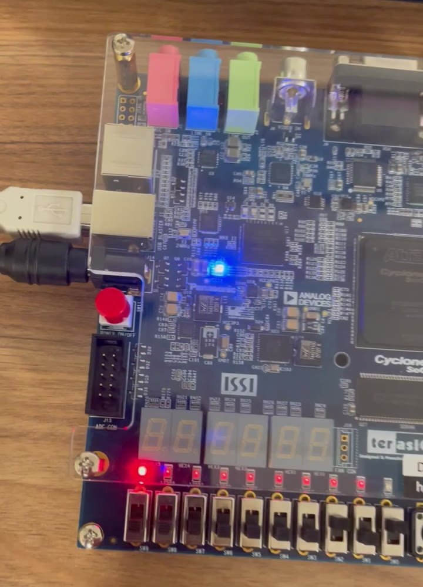

# DE1-SoC FPGA Projects (ECE 1551 Digital Logic)

Two small VHDL designs for the Terasic DE1-SoC board (Intel Cyclone V, `5CSEMA5F31C6`), built in Quartus Prime Lite 24.1 for ECE 1551 Digital Logic at Florida Tech (Spring 2026).

| Project | What it does | Board I/O |
|---|---|---|
| [`01_Blinky_and_Switch`](01_Blinky_and_Switch) | A slide switch drives an LED directly (pure combinational logic) | SW0 → LEDR0 |
| [`02_Combo_Lock`](02_Combo_Lock) (final project) | 3-bit combination lock, checked when the Enter button is pressed | SW2–SW0, KEY0, CLOCK_50 → LEDR9, LEDR0 |

## Demo



Combo lock running on the board: correct code lights LEDR9, wrong code lights LEDR0. Full video: [`media/combo_lock_demo.mp4`](media/combo_lock_demo.mp4)

## Repo layout

```
01_Blinky_and_Switch/   VHDL source, Quartus project files, compiled .sof
02_Combo_Lock/          VHDL source, Quartus project files, compiled .sof
docs/                   Step-by-step project guides and a DE1-SoC pin reference (PDF)
media/                  Demo video and photo
tools/openocd/          OpenOCD JTAG config for Cyclone V (third-party, see below)
```

## Build and program

1. Open the `.qpf` file in Quartus Prime Lite (24.1 or newer).
2. Processing → Start Compilation. Pin assignments are already in the `.qsf`.
3. Tools → Programmer → Auto Detect, select the `5CSEMA5` device, Change File → `output_files/<project>.sof`, then Start.

A pre-compiled `.sof` is included in each project, so step 2 is optional. The board needs its barrel-jack power supply plugged in, and programming won't work through a remote/virtual lab machine. The guides in [`docs/`](docs) walk through each step with screenshots.

## Docs

- [Blinky and Switch project guide](docs/Blinky_and_Switch_Project_Guide.pdf)
- [Combo Lock project guide](docs/Combo_Lock_Project_Guide.pdf)
- [DE1-SoC pin mapping guide](docs/DE1-SoC_Pin_Mapping_Guide.pdf): clock, KEY, SW, LEDR and HEX0 pin numbers

## tools/openocd

`altera-cyclonev.cfg` and `altera_common_init.cfg` are stock target configs from the [OpenOCD](https://openocd.org/) project (GPL-2.0-or-later), not my own work. They describe the Cyclone V JTAG chain for anyone using OpenOCD instead of the Quartus Programmer. The Quartus flow above doesn't need them.
